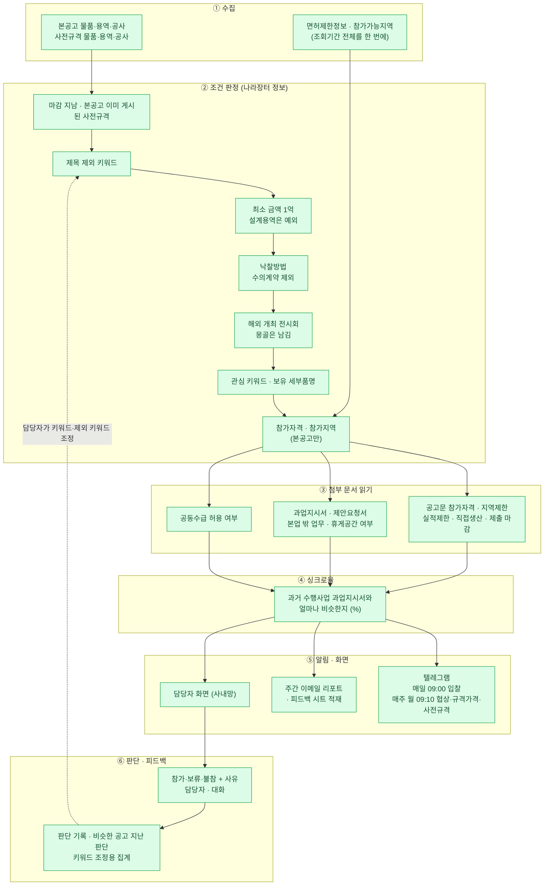

# 나라장터 입찰 모니터링 — 파이프라인 현황

갱신일: 2026-10-16

지금 코드가 공고를 **어떤 순서로 받고, 거르고, 알리는지** 한 장에 정리한 문서입니다.
판정은 전부 규칙(키워드·코드·금액·자격·첨부 문서 문장 규칙)과 과거 사업 대조로 하며, **LLM(생성형 AI)은 쓰지 않습니다.**

## 전체 흐름

## 단계별 설명

### ① 수집

`src/api/` · 공공데이터포털 API로 본공고(입찰공고정보서비스)와 사전규격(사전규격정보서비스)을
물품·용역·공사 3종씩, 6개 조회로 받습니다. 페이지 나눔·재시도·일부 실패 처리를 포함합니다.

면허제한정보와 참가가능지역은 공고 한 건씩 묻지 않고 **조회기간 전체를 한 번에** 받아 공고번호로 묶습니다.
공고 조회와 동시에 출발시켜 시간을 아낍니다.

### ② 조건 판정 (나라장터 정보)

`src/pipeline.ts` → `src/matching/matchEngine.ts`. 아래 순서로 보고, 하나라도 걸리면 목록에서 뺍니다.
같은 판정을 `src/matching/diagnose.ts`가 단계별로 끝까지 돌려 화면의 '제외된 공고' 탭에 **왜 빠졌는지**를 보여 줍니다.

| 순서 | 단계 | 기준 | 설정 |
|---|---|---|---|
| 1 | 마감 | 마감 지난 본공고, 의견 마감 지난 사전규격 | — |
| 2 | 본공고 게시 | 사전규격인데 본공고가 이미 나왔으면 본공고 쪽에서 봄 | — |
| 3 | 제외 키워드 | 제목에 제외 키워드 (공백 무시) | `keywords.json` `excludeKeywords` |
| 4 | 최소 금액 | 추정가격 1억 미만. 금액을 모르면 통과, **설계용역은 금액 기준 없음** | `minBudgetAmount`, `minBudgetExemption` |
| 5 | 낙찰방법 | 협상·규격가격동시·입찰만 (수의계약 제외). 모르면 통과 | `allowedBidMethods` |
| 6 | 해외 개최 | 제목에 한국관(한국관광 등 다른 낱말 제외), 전시회·박람회 + 단체관, 해외 지명(도쿄·두바이·TOKYO 등) + 단체관, 영문 국가 약자(USA·UAE·UK) 중 하나면 제외. **몽골은 남김** | `overseas-venue-keywords.json` |
| 7 | 키워드·품목 | 제목·세부품명 이름에 관심 키워드, 또는 세부품명(지일 등록 품목). 업종만 맞는 공고는 받지 않음 | `keywords`, `held-qualifications.json` |
| 8 | 참가자격 | 조경·토목 등 지일 분야가 아닌 면허를 필수로 요구하거나, 용역·공사에서 요구 업종을 하나도 보유하지 않으면 제외. 일부만 없으면 **빼지 않고 '자격 미보유'로 표시** (공동수급 검토) | `excludeRequiredLicenses`, `held-qualifications.json` |
| 9 | 참가지역 | 지역제한에 본점(강원) 지역이 없으면 제외 | `company-profile.json` |

등급: 코드(세부품명·업종)와 키워드가 **둘 다** 맞으면 `강력추천`, 하나만 맞으면 `참고용`.

### ③ 첨부 문서 읽기

나라장터 API는 제목 한 줄만 주기 때문에, 남은 공고는 첨부(HWP·HWPX·PDF·오피스, 스캔본은 OCR)를 받아 문장 규칙으로 읽습니다.

| 읽는 것 | 위치 | 쓰임 |
|---|---|---|
| 공고문 참가자격 (업종·물품, 직접생산, 실적제한) | `src/matching/qualificationDoc.ts` | 사전규격처럼 면허제한정보가 없는 공고의 자격 판정. 없는 업종이 있으면 제외 (단, 보유 자격 중 맞는 게 학술·연구용역뿐이면 컨소시엄 검토로 남김, 건축사사무소는 없어도 남김) |
| 첨부 지역제한 | 같은 파일 | 본점 지역이 없으면 제외 |
| 과업 범위 | `src/matching/taskScopeFlags.ts` | 유물 운송·대여·운영·홍보 같은 본업 밖 업무 표시. 사업 목적이 휴게·독서 공간 조성이면 제외 |
| 제안서 제출 마감 | `src/matching/submissionDeadline.ts` | 마감 칸에 표시 |
| 공동수급 허용 여부 | `src/api/jointBidApi.ts` | 표시 전용 (본공고만) |

첨부로 빼는 판정은 담당자 화면(`scripts/ui.ts` `docExclusion`)에서 첨부를 다 읽은 뒤에 적용하며, 빠진 공고는 '제외된 공고' 탭에 사유와 함께 남습니다.

### ④ 싱크로율

`src/similarity/` · 지일이 과거에 수행한 사업의 과업지시서(코퍼스, 암호화해 저장소에 보관)와
공고의 과업 내용을 TF-IDF·코사인 유사도와 본업 낱말 근거로 비교해 **%로 보여 줍니다**.
첨부를 못 읽으면 제목 기준으로 계산합니다. 순위·표시용이며 공고를 빼는 데는 쓰지 않습니다.

### ⑤ 알림 · 화면

| 매체 | 언제 | 내용 | 위치 |
|---|---|---|---|
| 텔레그램 | 매일 09:00 | 전날 게시된 **입찰**(적격심사·최저가 등) 본공고. 없으면 '새 공고 없음' | `src/index.ts` `runDaily` |
| 텔레그램 | 매주 월 09:10 | 지난 7일 게시된 **협상·규격가격동시** 본공고와 사전규격 | `src/index.ts` `runWeekly` |
| 이메일 · 피드백 시트 | 매주 월 | 지난 7일 전체 리포트, 구글 시트에 공고 행 적재 (설정돼 있을 때) | 같은 곳 |
| 담당자 화면 | 상시 (사내망) | 공고 목록·필터, 제외된 공고와 사유, 아래 별도 칸 | `scripts/ui.ts`, `scripts/ui.html` |

- 정기 실행은 GitHub Actions가 돌리고, 외부 예약 서비스(cron-job.org)가 정시에 깨웁니다. GitHub 예약 실행은 예비이며, 같은 기간 보고를 두 번 보내지 않습니다.
- 실행이 실패하거나 일부 대화방에만 못 가면 담당자 방이 아니라 **개발자 대화방**으로 알립니다.
- 카카오톡 알림톡은 보류입니다 ([도입 제안](카카오톡_알림_도입_제안.md)).

담당자 화면의 별도 칸:

| 칸 | 무엇 |
|---|---|
| 보유 품목 공고 | 보유 세부품명과 같지만 키워드·금액 등으로 목록에 없던 공고 |
| 검토필요 | 제목에 관심 키워드와 제외 키워드가 함께 있는 공고 |
| 첨부로 다시 볼 공고 | 제목의 제외 키워드 하나로만 빠졌는데, 첨부에 전시·제작 내용이 있는 공고 |

담당자가 '목록에 올리기'한 공고는 마감 말고는 어떤 조건으로도 빼지 않습니다.
마감이 지난 공고(본공고는 입찰 마감, 사전규격은 의견 마감)는 화면 어디에도 싣지 않습니다. 판단 기록 탭에 남은 기록은 그대로 둡니다.

### ⑥ 판단 · 피드백

담당자 화면에서 공고마다 참가·보류·불참과 사유(사유 버튼 + 글), 담당자, 대화를 남깁니다.
같은 주소로 들어온 팀원 모두가 같은 기록을 봅니다(`cache/participation.json`).

- **판단 기록 탭**: 판단을 사유와 함께 최근 순으로 모으고 CSV로 내려받습니다.
- **비슷한 공고 지난 판단**: 새 공고 카드에 제목이 비슷한 공고를 어떻게 판단했는지 함께 보여 줍니다.
- **키워드 조정용 집계**: 판단이 30건 이상 쌓이면 관심 키워드별 참가·보류·불참 수를 보여 줍니다. 불참이 대부분인 키워드는 제외 키워드나 키워드 삭제 후보입니다.

규칙 조정은 자동으로 하지 않습니다. 집계를 보고 담당자가 `config/*.json`을 고칩니다.

## 아직 판정하지 않는 것

- **실적제한·직접생산확인**: 공고문에서 읽어 표시만 합니다. 회사 실적 대장과 직접생산확인증명서 보유 현황이 있어야 자동 판정할 수 있습니다.
- **신용평가·경영상태·기술인력 같은 배점 항목**: 다루지 않습니다. 이 서비스는 "참가할 수 있는가"까지만 봅니다.

## 관련 문서

- [PoC4 — 협상계약 자격요건 스캔규칙 검증](PoC4_협상계약_자격요건_스캔규칙_검증.md)
- [싱크로율 매칭 기준데이터](싱크로율_매칭_기준데이터.md)
- [카카오톡 알림 도입 제안](카카오톡_알림_도입_제안.md)
- [HANDOFF.md](../HANDOFF.md) — 배포 구조 주의사항
